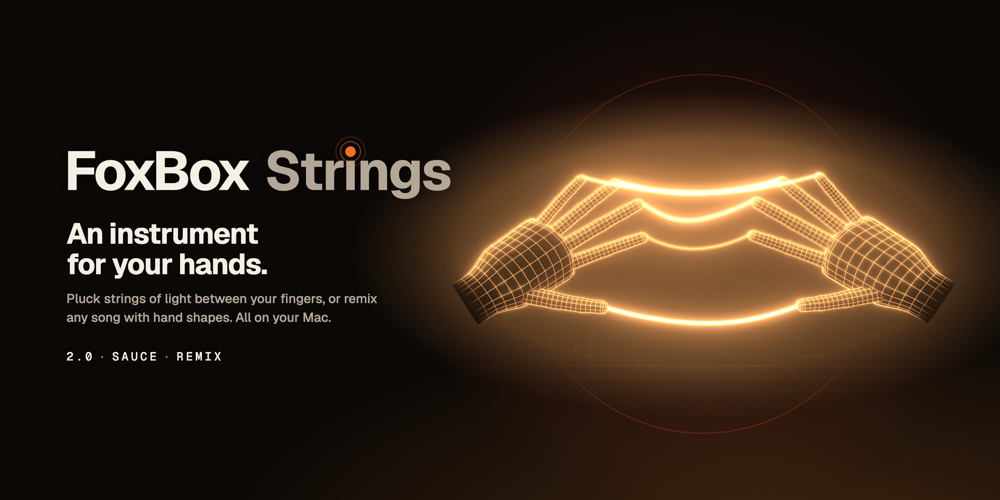
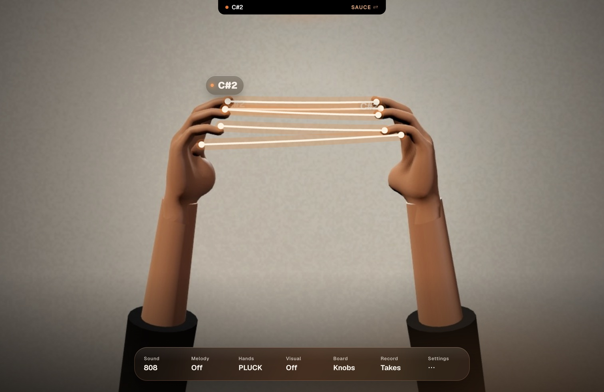
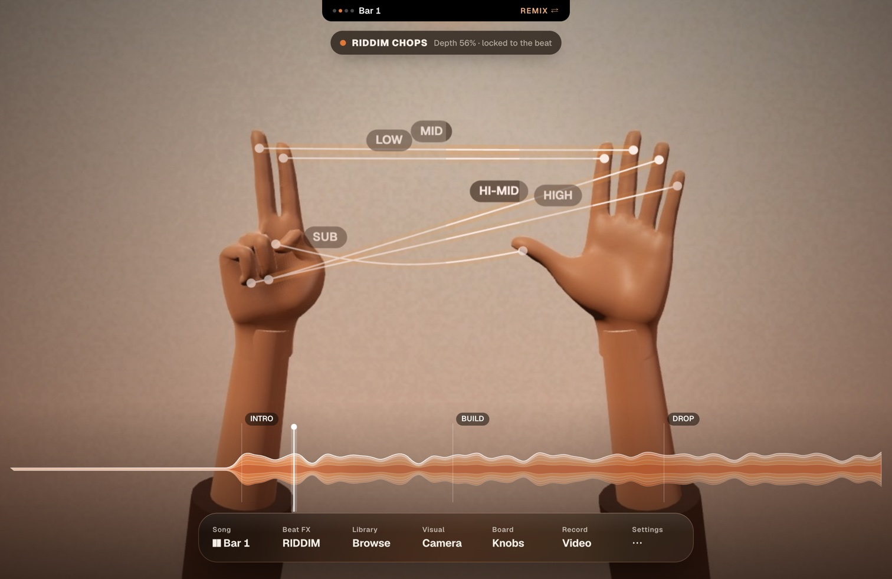
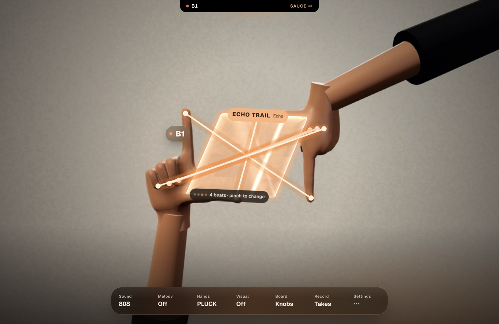
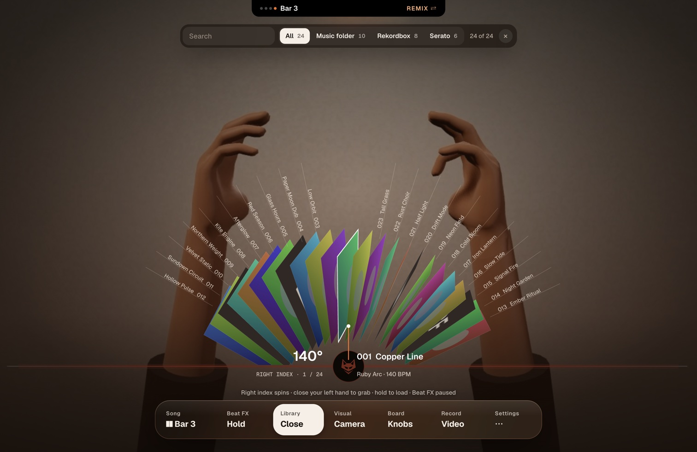
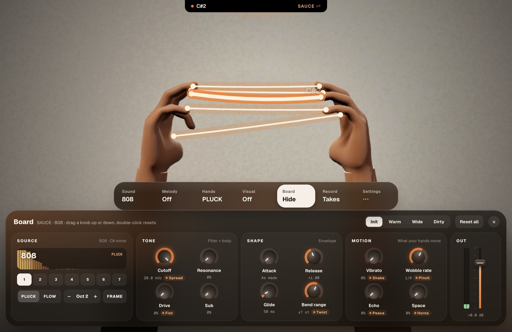

<div align="center">



<br/>

### An instrument for your hands.

**Hold your hands up to the camera and play.**

SAUCE · REMIX

Curve your hands into a C and strings of light stretch between your fingertips. Pluck them to make sounds, or load a song
and remix it with hand shapes locked to its beat. Everything runs on your Mac.

<br/>

[](https://github.com/als7294/FoxBox/releases/latest)


</div>

<br/>

> **Looking for STUDIO, VISUALS, MASKS or the voice mask?** FoxBox 2.0 is the hands instrument only. The full 1.5 toolkit
> stays available as [FoxBox 1.5.5](https://github.com/als7294/FoxBox/releases/tag/v1.5.5).

## 🎸 SAUCE: make sounds



FoxBox opens here. No song, no setup: your first note plays within seconds.

- **The pose:** both hands curved into a C, turned a little toward the camera, thumbs in front.
- **Pick a note** by raising or lowering a hand. The notes stay in key, and each hand shows its note.
- **Curl a finger to pluck.** Faster is louder; keep it curled to hold the note. Two hands play two notes.
- **Twist your wrists** to bend, **shake** for vibrato, and **point up or down** to change octave.
- **Hand shapes add effects:** ✊ DRIVE · 🤏 WOBBLE · ✌️ ECHO · 🤘 SPACE.
- **Seven sounds:** 808, REESE, GROWL and WOBBLE basses, and PLUCK, LEAD and KEYS (keys 1–7). Any key and scale.
- **Melodies:** pick one and pluck to play it in your own rhythm (FOLLOW), or let it guide your notes (FIT). 🎲 rolls a new one.
- **FLOW:** your right hand sets the pitch and your left makes the shapes.

## 🎛 REMIX: remix any song



Load a track from your library, drop one on the window, or try the test beat. FoxBox splits it into stems on your Mac and
starts two bars before the drop.

- **Hold a hand shape** and its effect plays, locked to the beat. Let go and the song snaps back in time.
  ✊ **TEAROUT** · ✌️ **RIDDIM CHOPS** · 🤏 **WOBBLE** · 🤘 **HALFTIME** · 👇 **SUB DROP** · ☝️ **BUILD ROLL** (let go: the drop).
  Raise your hand for more. Two hands play two effects.
- **Fold a finger to cut its band:** SUB · LOW · MID · HI-MID · HIGH.
- **Stretch** the strings for tension, **tilt** them to slide the 808, and **shake** them for vibrato.
- **Jump between sections** (INTRO, BUILD, DROP…). Every jump lands on the bar.

## 🪟 Frames



Make a frame with your thumbs and index fingers. **The last 4 beats loop inside it, picture and sound.**

- **Pinch and hold for a moment** to change the effect, each style with its own sound: ECHO TRAIL, PRISM, HALFTONE, KALEIDO, DATAMOSH and THERMAL.
- **Turn both hands over, like turning a card,** for the style's flip side: a different look and sound, with the loop played backwards.
- **Let go** (REMIX) or **frame again** (SAUCE) and it shatters back to live.

## 💿 The library wheel



Hold the shaka 🤙 (or press **L**) and your music fans up out of the waveform as a dome of record sleeves.

- **Your right index finger is the dial.**
- **Close your left hand** to pull a sleeve out and hear a preview. **Hold** it to load the track.
- It reads a music folder, a **Rekordbox** XML export or your **Serato** library, with search, playlists and crates.

## ✨ Make it yours



- **Board:** knobs and faders for the sound (tone, envelope, motion) or the song (stems, bands, master).
- **Visuals:** Bars, Halo, Silk, Grain or Scope. In SAUCE they play over the camera; in REMIX they wrap around the waveform.
- **Edit shapes** (in Hands or Beat FX): choose what each hand shape does.
- **NOTE PICKING** by height or by the space between your hands, and **pluck sensitivity** (Settings → Playing).
- **Left-handed layout** (Settings → Playing): in FLOW your left hand plays and your right makes the shapes, and the library dial is your left index.
- **Record:** WAV takes in SAUCE, video with sound in REMIX. Drag them straight into Ableton, Rekordbox or Finder.
- **Send to output:** the picture full screen on a projector or a stream.
- **Face hiding** is there if you want it (off by default).
- **The GUIDE** walks you through every move with your own camera. Press **G** to replay it.

## Install

> **Requires:** Apple silicon (M1 or newer) · macOS 14+ · a camera (built in or USB).

1. Download the **`.dmg`** from [**Releases**](https://github.com/als7294/FoxBox/releases/latest), open it, and drag **FoxBox** into **Applications**.
2. **First open only:** FoxBox isn't notarized by Apple yet, so macOS asks once.
   - **macOS 14:** right-click FoxBox → **Open** → **Open**.
   - **macOS 15+:** open it once and click **Done**, then go to **System Settings → Privacy & Security → Open Anyway**.
3. **Allow the camera** when macOS asks. SAUCE needs no downloads. REMIX downloads the stem splitter (84 MB) the first time you split a song.
4. **Updates install at startup:** FoxBox checks GitHub Releases, verifies each download's SHA-256, and restarts into the new version. **WHAT'S NEW** then shows what changed.

**Already on 1.5?** FoxBox updates itself to 2.0. Your files stay where they are, and 1.5.5 is still on the
[Releases](https://github.com/als7294/FoxBox/releases/tag/v1.5.5) page.

**Privacy:** the camera, your hands and your music never leave the Mac. The only network use is the update check (GitHub)
and the one-time stem splitter download.

## Under the hood

```
Electron app (React · TypeScript)       camera · updater · drag-out · output window
   ├── hand tracking    MediaPipe hands in a worker · hand shapes · plucks · frames
   ├── strings          three.js / WebGL2 strings, frames, visuals and the library wheel
   ├── SAUCE            Tone.js instruments · melodies · the Board
   └── REMIX            song deck · beat-locked FX · live stems · the library (folder, Rekordbox XML, Serato)
        │  token-authenticated, loopback only
Python engine (FastAPI · uv)            songs · structure and beat analysis · HT-Demucs stems on MLX
```

<details>
<summary><b>Build from source</b></summary>

```bash
cd engine && uv sync --all-packages      # Python 3.12
scripts/check.sh all                     # engine tests + app tests
scripts/dev.sh                           # run the app against the local engine
```
</details>

## Credits

<div align="center">

**Designed by [SmittyTech](https://github.com/als7294)**

Built on open-source work by many people; see [THIRD_PARTY_NOTICES.md](THIRD_PARTY_NOTICES.md). **What you play is yours.**

<sub>[GPL-3.0](LICENSE). FoxBox ships mutagen (GPL-2.0-or-later) to read your music's tags and artwork, so the app is GPL-3.0 as a whole.
Model weights download at runtime under their own licenses; the stem splitter's weights (Demucs, by Meta) are provided for scientific
use only, as FoxBox says before the download.</sub>

</div>
