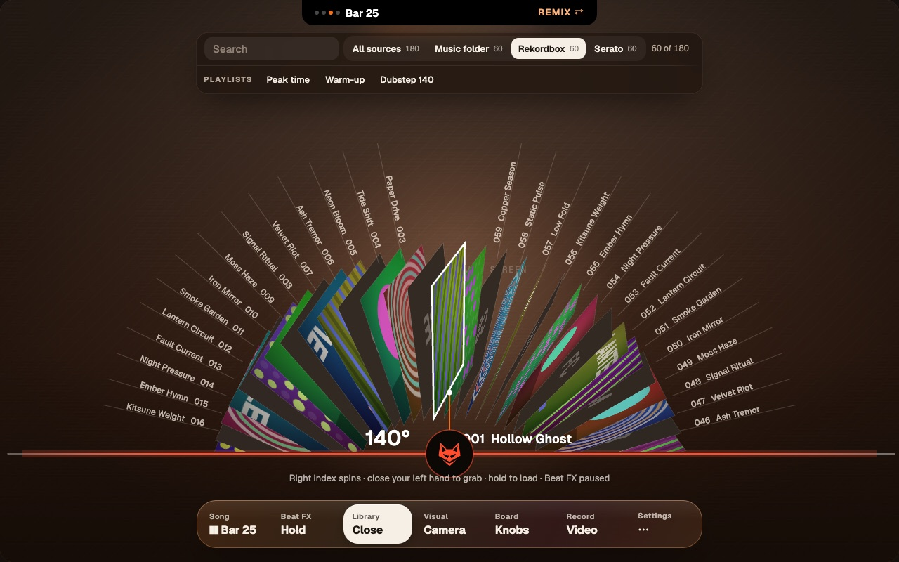
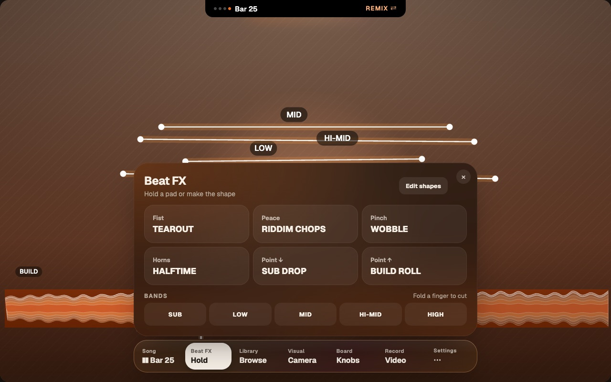
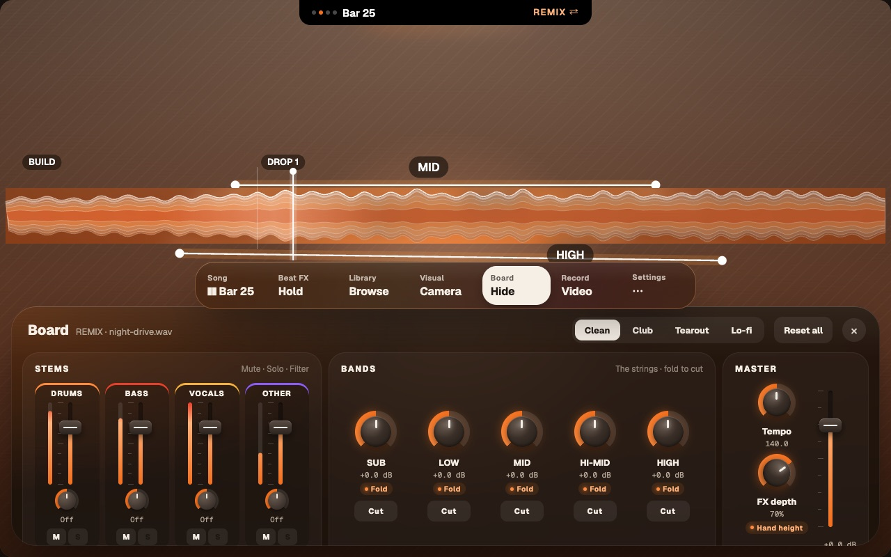

# FoxBox 2.0: the compact layout (1280×800)

The handoff (`app/design/foxbox-2/README.md`) is drawn at 1512×982. It asks that 1280×800 keep every primary action visible, and leaves the dock and library bar's compact pass undesigned. This is that pass.

Only sizes change. Colours, type, motion, copy and behaviour stay as the handoff specifies. I measured it on the handoff prototype re-rendered at 1280×800 with these values:

- 
- 
- 

## When it applies
The compact layout applies when the window is narrower than 1440 or shorter than 900:

```css
@media (max-width: 1439px), (max-height: 899px)
```

It switches live as the window is resized. Anything larger gets the design's sizes.

## Dock (both modes)
The dock keeps its share of the window: 840/1512 ≈ 720/1280.

| | Design | Compact |
|---|---|---|
| Width | 840 | **720** |
| Bottom | 28 | **20** (356 with the Board open) |
| Padding / gap | 8 / 6 | **6 / 4** |
| Radius, dock / button | 32 / 24 | **28 / 21** |
| Button height | 68 | **56** (hit area stays ≥ 24) |
| Button side padding | 16 | **12** |
| Label / value text | 12 / 18 | **11 / 16** |

- **REMIX's Song button is `flex: 1.2`** at both sizes. "❚❚ Bar 127" is 87 px wide against 81 px of room at 1512, and 77 against 74 at compact, so a song past bar 99 clips. With 1.2, every value fits at both sizes. WOBBLE, the tightest, gets exactly 77 of 77 at 1512 and 68 of 71 at compact.
- **The waveform** box is 96 tall (was 112), and its bottom sits 18 above the dock, as in the design.

## Popovers
- **Width:** popovers follow the dock, so they're 720 wide, rising from 76 above the dock's bottom.
- **Spacing:** padding 22 (was 28), gap 14 (was 18), radius 30 (was 34).
- **Height:** each popover is capped at the window height − 36 (Island) − 16 − its bottom offset. Past that the body scrolls, while the header and × stay put. None of the measured popovers needs to scroll.
- **Measured heights at compact:**

  | Popover | Height |
  |---|---|
  | Sound | 381 |
  | Melody | 398 |
  | Hands | 422 |
  | Beat FX | 363 |
  | Song | 342 |
  | Record | 317 |
  | Visual | 253 |

- **Hands with Edit shapes open** measured 698, which hit the Island. In compact, the PLUCK gestures column folds away while editing, since you're editing shapes then, not reading gestures. The six shape cards go into one row of six, and the edit panel sits below. That brings it to 558 with nothing cut.

## Library bar
- **Size:** top 46 (was 52) and 44 tall (was 52).
  - Search: 168 × 34 (was 200 × 40).
  - Source buttons: 30 tall (was 34), 13 / 11 px text (was 14 / 12).
  - Count: 12 px (was 13).
- **Width:** it fits its content, centred, up to 1100 px or the window width − 48.
- **Playlists, crates and folders move to a shelf row** under the bar. The shelf starts with its label (PLAYLISTS / CRATES / FOLDERS, Geist 700 11 px, 0.12em, `#B5A798`), has a hairline above it, and scrolls sideways, with a 40 px fade at the right edge.
  - **Recommended at 1512 too.** The prototype shows three playlists, but real Rekordbox and Serato libraries have dozens. Inline, they overflow the bar at any width.

## Library wheel
- **The ring stays full size.** Its dome is about 440 above the line. In compact the line is at y 646, so the dome's top is near 205, clear of the bar and shelf (bottom 134). Its labels span about ±494 around the centre, inside 1280.
- **The grab card** is anchored 60 above the waveform line (was a fixed y 560), and its full pull is ×0.8 (was ×1.0). At full pull it's 262 × 406 at y 180, clear of the shelf, with the dial readout below it still showing.
  - At 1512 the full-pull card is 328 × 508 at y 52, so it covers the source bar. That's fine if it's intended.
- **The hint** ("Right index spins · close your left hand to grab…") goes **26 below the folded line**. The design puts it half a waveform plus 22 below the line, which lands it behind the dock at both sizes, so it never shows.

## The REMIX Board
- **At 1280 its columns collide.** The fixed columns (430 + 330 + 210) leave BANDS 216 px for five 62 px knobs, so the knobs overlap the BEAT FX pads.
- **The fix, in compact:** the Board's BEAT FX card folds away. The dock's Beat FX popover has the same six pads, so nothing is lost. The columns become `430px minmax(0,1fr) 210px`, and BANDS gets about 550 px.
- **The SAUCE Board fits as designed.**

## Also in the design, at both sizes (for S4)
- **The Board's bottom row is cut off:** the stems' M/S buttons and the master fader's dB readout. The 332 px box is shorter than its cards. Fit the cards, or grow the Board to about 344.
- **Two tags are 10.5 px:** the Board's hand tags (Spread, Fold…) and the Hands popover's LIVE tag. That's under the design's own 11 px floor, so use 11.
