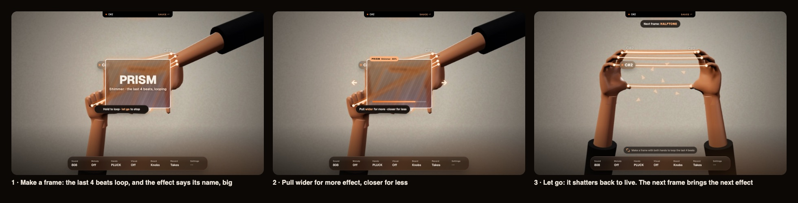

# Frames, simplified (approved for 2.1)

The user: "frames are insanely confusing". Today a frame has five rules: it latches in SAUCE but is held in REMIX, a held pinch changes the style, turning the hands over gives the flip side, and making it again releases it. One-handed adds its own variant.

**The proposal: one rule. Hold a frame and it loops; let go and it stops.** It's the same in SAUCE and REMIX, with two hands or one.

## How it works
1. **Make a frame** with both hands, two L's (one L in one-handed mode). The last 4 beats loop inside it, picture and sound, for as long as you hold it.
2. **The effect names itself, big,** for about a second (just "PRISM": big text or no text; the pill carries "Shimmer · 80%"). Then the name shrinks to the pill on the frame's edge.
3. **Pull wider for more,** closer for less. The frame's size is the effect's amount, measured from the size it was made at (which starts at 50 %). A thin bar on the frame shows it.
4. **Let go:** the quick glass shatter, and you're back to live.
5. **Each new frame brings the next effect:** ECHO TRAIL → PRISM → HALFTONE → KALEIDO → DATAMOSH → THERMAL. As you let go, a toast says what's next: "Next frame: HALFTONE". To pick one directly, use the Board's FRAME control.

**Always-visible "how":**
- **Not framed:** a quiet chip above the dock, "Make a frame with both hands to loop the last 4 beats", until you've made 3 frames.
- **Framed:** a chip under the frame, "Hold to loop · let go to stop", which turns into "Pull wider for more · closer for less" after a second.

**The flip side stays, untaught** *(the PM's ruling)*: turning both hands over still flips onto the style's partner, with the loop reversed. It has no cue and no GUIDE step.

**While framed,** other shapes pause in both modes, as REMIX already does. **Keys:** F toggles a frame on and off (for anyone who can't hold the pose), and P skips to the next effect.

## Melody mode (2.1)
With MELODY on LOOP (docs/STRINGS_UX.md, "Melody mode"), **any inward frame counts**: any two L's that enclose space between the hands, in any orientation. The frame doesn't capture "the last 4 beats". It applies its effect to the playing melody loop, on the next beat, with the same rules: hold = on, size = amount, let go = off, and each new frame is the next effect.

**S1's lenient inward-L test:**
- **Each hand:** thumb and index are extended and roughly perpendicular (60–120°); the other fingers can be loose.
- **The pair:** the two corners face each other, so each L's opening points toward the other hand. The four fingertips then bound a quadrilateral of ≥ 2% of the picture, between the hands.
- **Rotation and handedness:** any rotation counts, and so does either hand being on top.
- **Timing:** it forms after 150 ms, and ends after 300 ms out, as now.

## The GUIDE in one step
> **Make a frame with both hands.** It loops the last 4 beats. Pull wider for more. Let go to stop.

The demo shows the frame forming, "PRISM" big, the frame widening, the hands letting go, the shatter, then "Next frame: HALFTONE". "Now you try" is to hold a frame for 1 s and get the tick.

## What we cut, and why
| Cut | Why | What it costs |
|---|---|---|
| **The latch** (SAUCE) | The two different behaviours, and "make it again to release", were the main confusion. | You can't pluck over a loop with both hands busy. F (toggle) still does it, and a pedal could later. |
| **Pinch to change the style** | A held pinch inside a frame is awkward. It fights plucks and WOBBLE, and it needed a 0.2 s rule. | Nothing: "next frame = next effect" plus the Board covers it. |
| **Per-mode differences** | One rule is learnable without reading. | REMIX loses nothing; it was already "held". |

## Who changes what
- **S1:** remove the latch and pinch-cycle gating (keep the flip); add the frame's size as an amount (0–1, relative to the size at creation); one-handed's L is held the same way.
- **S2:** the amount drives the effect's depth.
- **S3:** the big name for 1 s, then the pill; the amount bar.
- **S4:** the cue chip, the "Next frame" toast, the GUIDE step, and F as a toggle.

*Storyboards are drawn over RC0 frames of the generated hand clips (no faces). S1's real-camera clips weren't available yet.*
